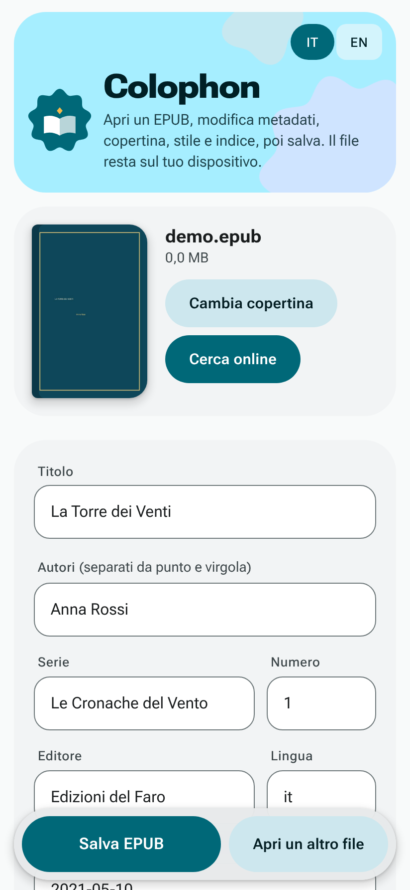
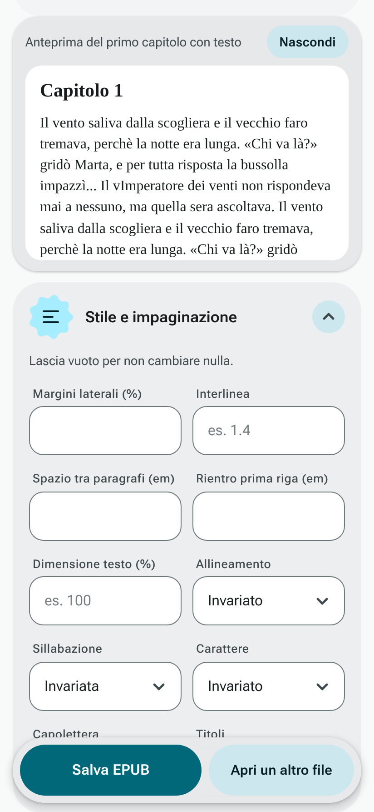
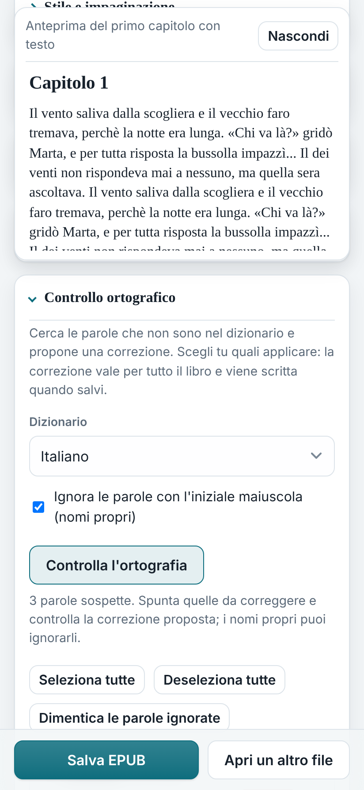
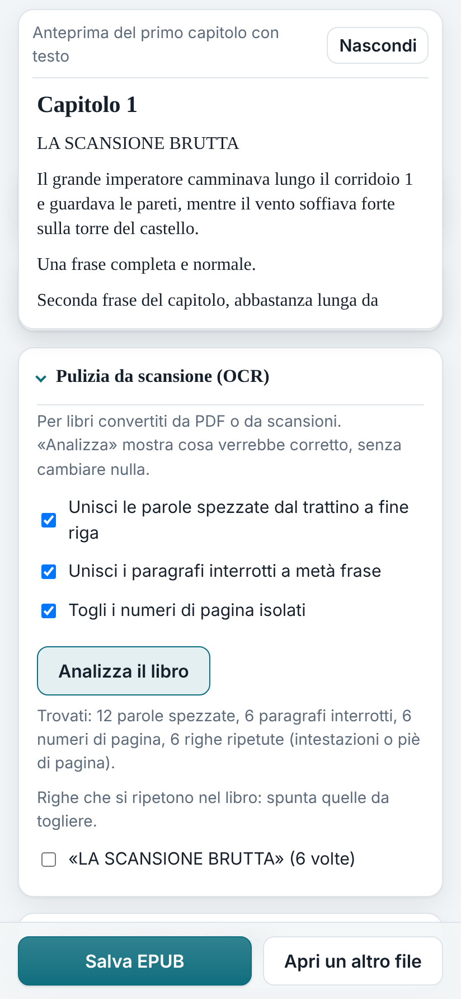
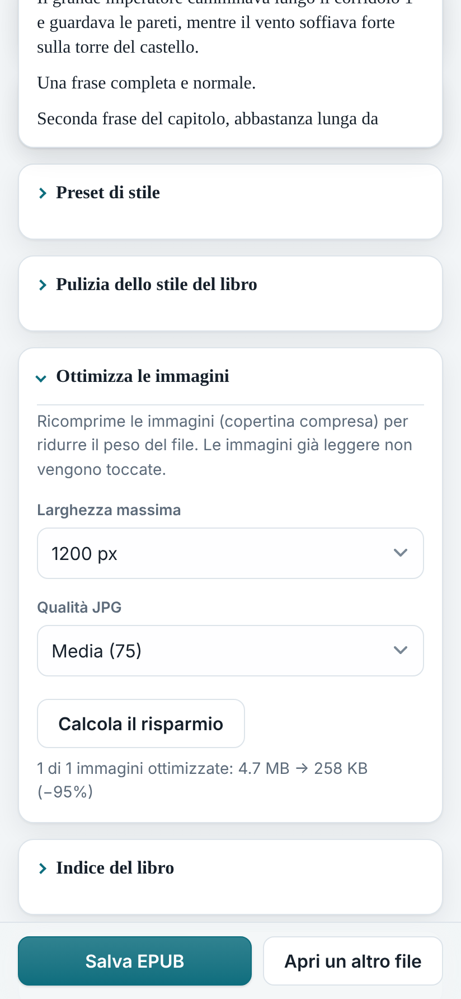
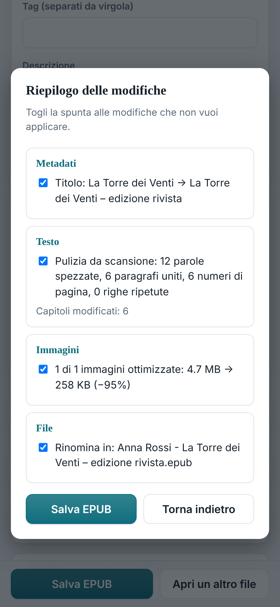
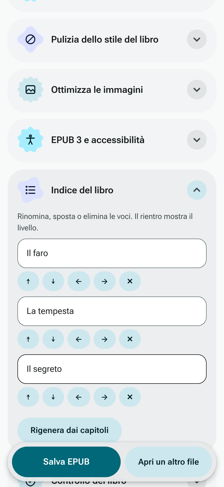
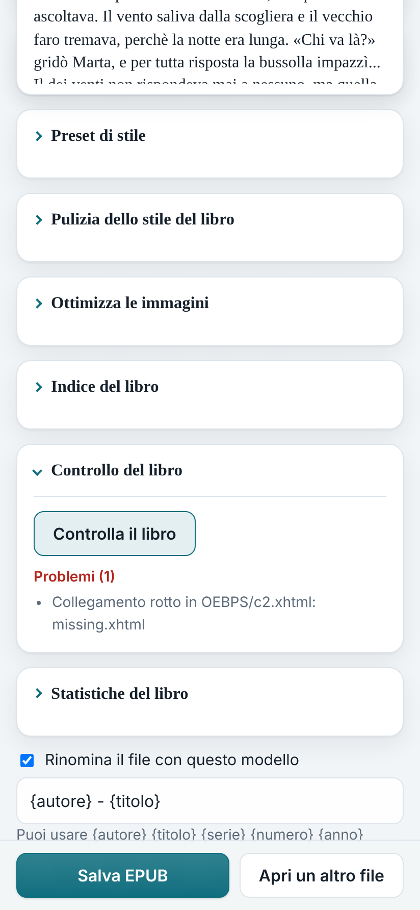
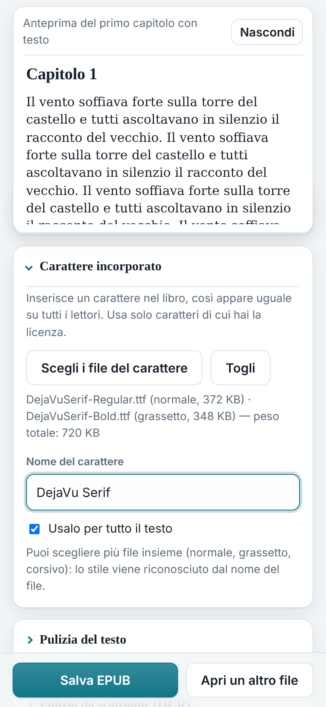
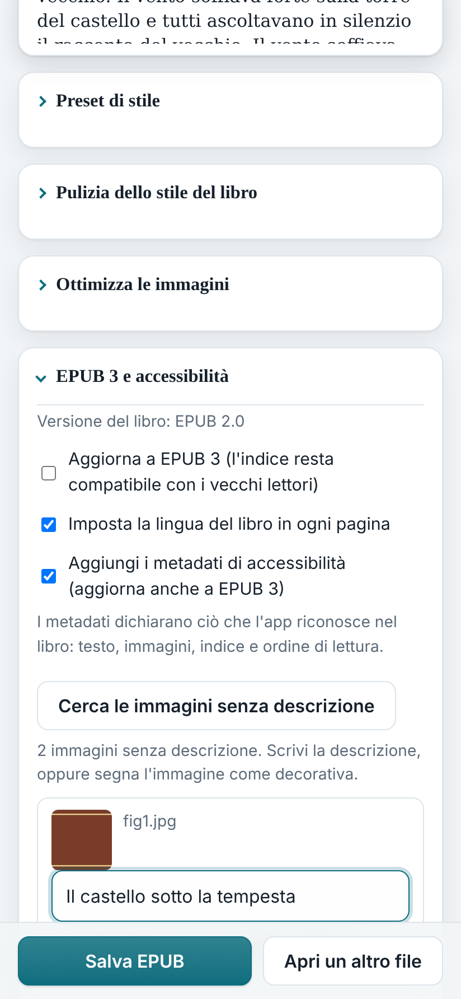

  

<h1 align="center">Colophon</h1>

  <a href="#english">English</a> · <a href="#italiano">Italiano</a>

  <strong>A free EPUB editor that runs in your browser, even offline.</strong> 
  <a href="https://colophon-editor.pages.dev">colophon-editor.pages.dev</a>

---

## 🇬🇧 English

**Colophon** is a web app (PWA) to edit **EPUB** files directly in your browser: metadata, cover, style, table of contents, and text. It is a lightweight alternative to Calibre's editing features, working on Chromebook, Android, Windows, macOS, and Linux. It can be installed like a regular app and used offline after the first visit.

> **Privacy:** Your books are never uploaded to any server. Every file is read, edited, and saved locally. The original file is never modified; saving creates a new file.

### ✨ Key Features

- **Metadata & Cover:** Edit title, authors, series, publisher, etc. Replace cover. Online lookup (Google Books / Open Library). File renaming with templates.
- **Style & Layout:** Live preview of margins, line height, fonts, hyphenation, drop caps. Save and apply style presets. Embed custom fonts (TTF, OTF, WOFF, WOFF2).
- **Text & Scan Cleanup:** Fix quotes, apostrophes, ellipses, double spaces. OCR cleanup: join hyphenated words, remove stray page numbers/headers.
- **Spell Checker:** Offline Hunspell engine (Italian/English). Suggests fixes per occurrence.
- **EPUB 3 & Accessibility:** Upgrade EPUB 2 to EPUB 3. Add image alt text, set page languages, and inject schema.org accessibility metadata.
- **Images:** Optimize and recompress JPG/PNG with a preview of space saved.
- **Book Structure:** Edit table of contents, run book checks (broken links, missing files), view statistics, and compare before/after chapters.
- **Interface:** Material 3 Expressive design, automatic light/dark theme, fully responsive, and installable as a PWA.

### 📸 Screenshots

<table>
  <tr>
    <td align="center"> Metadata</td>
    <td align="center"> Style</td>
    <td align="center"> Spell Check</td>
    <td align="center"> Scan Cleanup</td>
  </tr>
  <tr>
    <td align="center"> Images</td>
    <td align="center"> Summary</td>
    <td align="center"> Contents</td>
    <td align="center"> Book Check</td>
  </tr>
  <tr>
    <td align="center"> Embedded Font</td>
    <td align="center"> EPUB 3 & Accessibility</td>
    <td></td>
    <td></td>
  </tr>
</table>

### ⚙️ Project Structure

A static site: no build step, no backend.

| File | Description |
|---|---|
| `index.html` | The entire app (HTML, CSS, JavaScript) |
| `manifest.webmanifest`, `sw.js` | PWA installation and offline cache |
| `icon.svg`, `icon-192.png`, `icon-512.png` | App icons |
| `hunspell.bundle.js`, `dict/` | Spell checker engine and dictionaries |

**Libraries:** JSZip, hunspell-asm (MIT), Italian dictionary (GPL-3.0), English dictionary (MIT/BSD). Icons: Material Symbols (Apache 2.0).

---

## 🇮🇹 Italiano

**Colophon** è una web app (PWA) per modificare file **EPUB** direttamente dal browser: metadati, copertina, stile, indice e testo. È un'alternativa leggera alle funzioni di modifica di Calibre e funziona su Chromebook, Android, Windows, macOS e Linux. Si può installare come una normale app e usare offline dopo la prima apertura.

> **Privacy:** I tuoi libri non vengono mai caricati su nessun server. Ogni file viene letto, modificato e salvato localmente. L'originale non viene mai toccato: il salvataggio crea un nuovo file.

### ✨ Caratteristiche Principali

- **Metadati e Copertina:** Modifica titolo, autori, serie, editore, ecc. Sostituisci la copertina. Ricerca online (Google Books / Open Library). Rinomina file con modelli.
- **Stile e Impaginazione:** Anteprima in tempo reale di margini, interlinea, font, sillabazione, capilettera. Salva e applica preset di stile. Incorpora font personalizzati (TTF, OTF, WOFF, WOFF2).
- **Pulizia Testo e Scansioni:** Correggi virgolette, apostrofi, puntini di sospensione, spazi doppi. Pulizia OCR: unisci parole spezzate dal trattino, rimuovi numeri di pagina o intestazioni ripetute.
- **Correttore Ortografico:** Motore Hunspell offline (italiano/inglese). Suggerisce correzioni per ogni occorrenza.
- **EPUB 3 e Accessibilità:** Aggiorna EPUB 2 a EPUB 3. Aggiungi testo alternativo alle immagini, imposta la lingua delle pagine e inserisci metadati di accessibilità schema.org.
- **Immagini:** Ottimizza e ricomprimi JPG/PNG con anteprima del spazio risparmiato.
- **Struttura del Libro:** Modifica l'indice, esegui controlli (link rotti, file mancanti), visualizza statistiche e confronta i capitoli prima/dopo.
- **Interfaccia:** Design Material 3 Expressive, tema chiaro/scuro automatico, completamente responsive e installabile come PWA.

### 📸 Screenshot

<table>
  <tr>
    <td align="center"> Metadati</td>
    <td align="center"> Stile</td>
    <td align="center"> Ortografia</td>
    <td align="center"> Pulizia Scansioni</td>
  </tr>
  <tr>
    <td align="center"> Immagini</td>
    <td align="center"> Riepilogo</td>
    <td align="center"> Indice</td>
    <td align="center"> Controllo Libro</td>
  </tr>
  <tr>
    <td align="center"> Font Incorporato</td>
    <td align="center"> EPUB 3 e Accessibilità</td>
    <td></td>
    <td></td>
  </tr>
</table>

### ⚙️ Struttura del Progetto

Un sito statico: nessuna compilazione, nessun backend.

| File | Descrizione |
|---|---|
| `index.html` | L'intera app (HTML, CSS, JavaScript) |
| `manifest.webmanifest`, `sw.js` | Installazione PWA e cache offline |
| `icon.svg`, `icon-192.png`, `icon-512.png` | Icone dell'app |
| `hunspell.bundle.js`, `dict/` | Motore e dizionari del correttore ortografico |

**Librerie:** JSZip, hunspell-asm (MIT), dizionario italiano (GPL-3.0), dizionario inglese (MIT/BSD). Icone: Material Symbols (Apache 2.0).
